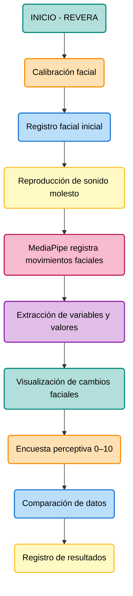

# *REVERA*

---

# 1. Definición del proyecto

### Tema

La relación entre la exposición al ruido cotidiano y el bienestar de las personas

### Problemática

Estamos constantemente expuestos a sonidos que forman parte de nuestra vida cotidiana. El tránsito, las construcciones, las conversaciones y otros estímulos sonoros se convierten en parte habitual de nuestro entorno. Con el tiempo, aprendemos a convivir con ellos e incluso a ignorarlos. Sin embargo, dejar de prestarles atención no necesariamente significa que dejen de influir en nosotros. Desde esta perspectiva, surge la necesidad de explorar la relación entre la exposición al ruido cotidiano, las respuestas del cuerpo y el bienestar de las personas.

### Pregunta de investigación

¿Cómo nos afecta el ruido que hemos aprendido a ignorar?

*¿Qué respuestas físicas y conductuales experimentamos frente a sonidos cotidianos, incluso cuando dejamos de prestarles atención?*

### Hipótesis

La exposición a sonidos molestos del entorno cotidiano puede provocar cambios observables en las expresiones faciales de las personas, asociados a respuestas de incomodidad o tensión, incluso cuando estos estímulos forman parte de su entorno habitual.

# 2. Información de las láminas

### Adquirir

*Captura de estímulos y datos*

¿Qué información recopilamos?

Se identifican y reproducen sonidos molestos del entorno cotidiano para exponer a las personas a distintos estímulos sonoros.

Durante la experiencia se adquieren dos tipos de información:
- Expresiones faciales: mediante MediaPipe se registran variaciones en el entrecejo, la boca y la nariz.
- Movimiento de cabeza: mediante el sensor MPU-6050 se obtiene la orientación de la cabeza para controlar la posición espacial del audio.

**Datos adquiridos:** landmarks faciales, variaciones de expresiones y orientación de cabeza.

### Analizar

*Observación de respuestas*

`¿Qué ocurre frente a los estímulos sonoros?`

Se examinan las variaciones de los puntos faciales detectados durante la exposición al sonido, buscando identificar patrones de movimiento asociados a posibles respuestas de incomodidad o tensión.

Se consideran tres zonas del rostro:
- **Entrecejo:** variaciones en la posición de las cejas y la zona entre ellas.
- **Boca:** cambios en la apertura y configuración de los labios.
- **Nariz:** variaciones en los puntos faciales de la región nasal.
El movimiento de cabeza se analiza como una variable de orientación que permite comprender cómo interactúa la persona con el espacio sonoro.

**Objetivo:** reconocer cambios observables en el rostro durante la exposición sonora, sin asumir que estos representan emociones específicas.

### Filtrar

*Depuración y selección de datos*

¿Qué información es relevante?

Se seleccionan y depuran los datos capturados para reducir interferencias y conservar las variaciones que resultan útiles para el análisis.
- Se seleccionan los landmarks correspondientes al entrecejo, la boca y la nariz.
- Se descartan lecturas incompletas o detecciones faciales inestables.
- Se suavizan las fluctuaciones de los datos para evitar movimientos bruscos o falsos cambios.
- Se normalizan los valores para facilitar su comparación.
En paralelo, los datos del MPU-6050 se utilizan para controlar la orientación espacial del audio.

**Resultado:** un conjunto de datos faciales más estable y organizado para su posterior interpretación.

### Minar

*Identificación de patrones*

¿Qué relaciones podemos encontrar?

Se buscan patrones y coincidencias entre los estímulos sonoros y las variaciones faciales registradas durante la experiencia.

Se comparan los cambios en las tres zonas del rostro para identificar:
- Frecuencia de las variaciones faciales.
- Intensidad de los cambios registrados.
- Momentos en que aparecen variaciones frente a determinados sonidos.
- Coincidencias entre diferentes estímulos sonoros y respuestas faciales.
También se consideran los movimientos de cabeza para observar cómo la orientación de la persona modifica su interacción con el sonido.

**Resultado:** identificación de patrones de respuesta facial frente a distintos estímulos sonoros.

### Representar

*Visualización de la información*

¿Cómo hacemos visibles los datos?

Los datos procesados se traducen en representaciones visuales que permiten observar los cambios faciales a lo largo del tiempo y relacionarlos con los estímulos sonoros reproducidos.

La información se presenta mediante:
- Gráficos temporales de las variaciones del entrecejo, la boca y la nariz.
- Indicadores visuales que muestran los cambios detectados.
- Registros sincronizados entre la reproducción del sonido y las respuestas faciales.
- Visualización del movimiento de cabeza y su relación con la espacialización del audio.

### Afinar

diagrama de flujo

### Interactuar

montaje

---

# 3. ¿Cómo funcionaría MediaPipe en REVERA?

MediaPipe Face Landmarker, una herramienta de visión computacional que permite analizar un rostro en tiempo real mediante una cámara.

`MediaPipe entrega:`

- 478 puntos de referencia tridimensionales del rostro.
- 52 coeficientes de movimientos faciales llamados Blendshapes.
- Información sobre la geometría y posición facial.
  
Esto nos permite observar variaciones en zonas específicas del rostro durante la escucha. 

**¿Qué expresiones podríamos registrar?**

|Zona facial |Variable MediaPipe| Qué podríamos observar|
|----|----|----|
|Cejas| browDownLeft, browDownRight| Descenso de las cejas|
|Entrecejo| browInnerUp| Elevación de la zona interior de las cejas|
|Ojos| eyeSquintLeft, eyeSquintRight| Contracción de los ojos|
|Párpados| eyeBlinkLeft, eyeBlinkRight| Parpadeos|
|Mandíbula| jawOpen| Apertura de la boca|
|Labios| mouthPressLeft, mouthPressRight| Compresión de los labios|
|Comisuras| mouthFrownLeft, mouthFrownRight| Descenso de las comisuras|

`Importante:` MediaPipe no determina directamente si una persona siente estrés, irritación o malestar. Sus valores describen movimientos faciales estimados. La relación con el malestar debemos estudiarla mediante nuestro experimento y contrastarla con la percepción de la persona.

# 3. Posible funcionamiento de la experiencia

