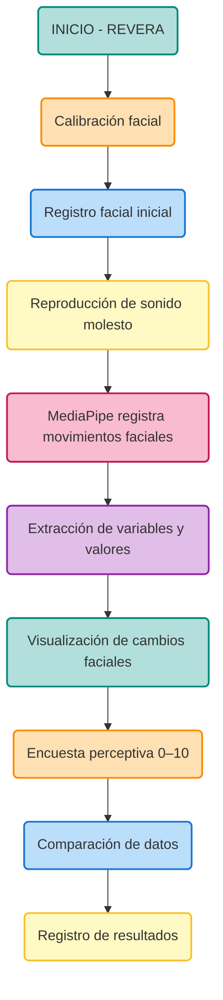

# *REVERA*

---

# 1. Definición del proyecto

### Tema

La influencia de los sonidos molestos del entorno cotidiano en el bienestar de las personas.

### Problemática

Estamos constantemente expuestos a estímulos sonoros provenientes del entorno, como el tráfico, las construcciones, las alarmas, los electrodomésticos o las voces.

Aunque muchas veces nos acostumbramos a estos sonidos y dejamos de prestarles atención consciente, su percepción puede continuar generando respuestas en nuestro cuerpo.

### Pregunta de investigación

¿Cómo nos afecta el ruido que hemos aprendido a ignorar?

### Hipótesis

La exposición a ruidos molestos del entorno cotidiano puede generar respuestas faciales y perceptivas asociadas al malestar, incluso cuando las personas no son plenamente conscientes de su reacción.

### Objetivo general

Explorar cómo la exposición a estímulos sonoros molestos puede influir en las respuestas faciales y perceptivas de las personas, mediante un sistema interactivo que permita registrar, visualizar y analizar sus reacciones durante la escucha.

### Objetivos específicos

- Registrar las respuestas faciales de una persona mediante MediaPipe Face Landmarker.
- Identificar cambios en determinados movimientos faciales durante la exposición sonora.
- Registrar la duración y frecuencia de las variaciones faciales observadas
- Contrastar los datos faciales con la percepción subjetiva de la persona.
- Representar visualmente la relación entre sonido, percepción y respuesta corporal.

# 2. ¿Cómo funcionaría MediaPipe en REVERA?

MediaPipe Face Landmarker, una herramienta de visión computacional que permite analizar un rostro en tiempo real mediante una cámara.

`MediaPipe entrega:`

- 478 puntos de referencia tridimensionales del rostro.
- 52 coeficientes de movimientos faciales llamados Blendshapes.
- Información sobre la geometría y posición facial.
  
Esto nos permite observar variaciones en zonas específicas del rostro durante la escucha. 

**¿Qué expresiones podríamos registrar?**

|Zona facial |Variable MediaPipe| Qué podríamos observar|
|----|----|----|
|Cejas| browDownLeft, browDownRight| Descenso de las cejas|
|Entrecejo| browInnerUp| Elevación de la zona interior de las cejas|
|Ojos| eyeSquintLeft, eyeSquintRight| Contracción de los ojos|
|Párpados| eyeBlinkLeft, eyeBlinkRight| Parpadeos|
|Mandíbula| jawOpen| Apertura de la boca|
|Labios| mouthPressLeft, mouthPressRight| Compresión de los labios|
|Comisuras| mouthFrownLeft, mouthFrownRight| Descenso de las comisuras|

`Importante:` MediaPipe no determina directamente si una persona siente estrés, irritación o malestar. Sus valores describen movimientos faciales estimados. La relación con el malestar debemos estudiarla mediante nuestro experimento y contrastarla con la percepción de la persona.

# 3. Posible funcionamiento de la experiencia

